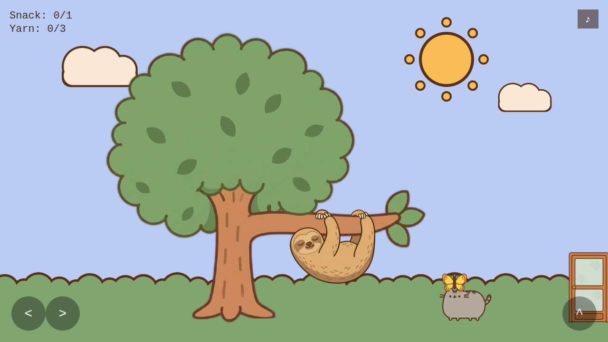

# Pusheen Cozy Game

***Pusheen's Lazy Afternoon*** — a small, cozy fan game: a plump cat potters
around a little connected house. She fetches juice to wake Sloth in the
backyard, finds a snack, helps Stormy find her yarn, and naps in a sunbeam,
while a shy butterfly drifts about the yard and now and then lands on her
head. No enemies, no timer, no fail state. It exists to test one thing — is
guided, low-stakes pottering around a house actually delightful, or just
pleasant-but-boring? See
`docs/pusheen-mvp-product-brief.md` for the full hypothesis and success
criteria.

An unofficial, non-commercial fan project. Pusheen and friends belong to
Pusheen Corp.; this game isn't affiliated with or endorsed by them.



## Play it

Live build: deployed to Netlify from `main` on every push.

https://pusheen-game.netlify.app/

## Controls

| Action | Keyboard | Touch |
|---|---|---|
| Move | Arrow keys / A, D | On-screen `<` / `>` buttons |
| Jump | Space / W / Up | On-screen `^` button |
| Interact (talk, open/close the cabinet or fridge, take an item) | E | On-screen `E` button |
| Select an item in the cabinet or fridge | 1 – 4 | Tap the item |
| Play again (after the nap) | Space | Tap the button |
| Sound on / off | — | ♪ button, top-right |
| How to play and the fan-project note | — | ? button, next to the ♪ |

A splash with the same information opens when the game loads; any key or a
tap closes it.

## Stack

- **Phaser 4** + **Vite**, vanilla JavaScript (no TypeScript, no backend).
- Static client only, deployed on **Netlify** from `main`. The one outside
  call is a cookieless [GoatCounter](https://www.goatcounter.com/) script
  on the live site only (see Privacy).
- Node.js 22 for tooling.

## Getting started

```bash
npm install
npm run dev      # dev server at http://localhost:8080
npm run build    # production build to dist/
```

## Project structure

| Path | Contents |
|---|---|
| `src/main.js` | Phaser game config + scene list |
| `src/splash.js`, `src/analytics.js` | The how-to-play splash; the production-only usage counts |
| `src/config/` | `feel.js` (all tunable movement/animation constants), `gameState.js` (run state), `audioManifest.js` (music + SFX sets) |
| `src/scenes/` | `Preloader`, the four rooms (`Backyard`, `Kitchen`, `LivingRoom`, `Bedroom`), `UI` (HUD, controls, peek panel; runs alongside) |
| `src/entities/` | One class per game object — `Pusheen`, `Sloth`, `Stormy`, `Butterfly`, `Container`, `Door`, … |
| `src/systems/` | Shared wiring: data layouts, interactions, reveals |
| `src/audio/AudioController.js` | Music/SFX playback, ducking, mute |
| `tools/` | Python scripts that cut concept art into sprites and the page's icons |
| `public/assets/` | Sprites and audio, served as static files |
| `docs/` | Specs, the art asset list and art prompts, and the concept art |

## Audio

The music starts with Pusheen's first move (a walk or a jump), not at
load. Each room has its own track (`ROOM_MUSIC` in `src/config/audioManifest.js`:
the garden and bedroom share one, the kitchen and living room have their own),
crossfading as she goes through a door. The music is three real tracks
(Kevin MacLeod's "Carefree" and "Wallpaper", jestar's "A Simple Trifle"; credits
and how they were prepared are in `public/assets/audio/CREDITS.md`). The sound
effects are still synthesized CC0 placeholders (generated via
`scripts/gen-placeholder-audio.mjs`). Swapping audio is a
drop-in-the-file-and-change-a-path change in `src/config/audioManifest.js`, no
logic changes needed.

## Status

Where things stand is in `HANDOFF.md`; what's next, in order, is in
`ROADMAP.md`. There's no automated test suite by design — the game is
validated through playtesting against the feel-based success criteria in
`docs/pusheen-mvp-product-brief.md`, not a checklist of features. See
`CLAUDE.md` for the project's working rules and `docs/` for the full spec set.

## Privacy

The live site counts visits and a few milestones (reached the kitchen, woke
Sloth, napped, played again) with [GoatCounter](https://www.goatcounter.com/),
which sets no cookies and stores no personal data, to tell whether the game is
fun to come back to. It's off in development and on deploy previews
(`src/analytics.js`).

## License and credits

- **Code:** MIT, see [`LICENSE`](LICENSE). Built with [Phaser](https://phaser.io/)
  (MIT) and [Vite](https://vite.dev/) (MIT); the build setup started from the
  Phaser Vite template.
- **Art and characters:** Pusheen, Sloth, Stormy and the other characters
  belong to Pusheen Corp. The art here is unofficial fan art, generated with
  Gemini and cut to size by the scripts in `tools/`. It is **not** covered by
  the MIT license, and no right to reuse it is granted. If you are the
  rights holder and want something changed or removed, please open an issue.
- **Music:** "Carefree" and "Wallpaper" by Kevin MacLeod
  ([incompetech.com](https://incompetech.com)), from the Free Music Archive,
  licensed [CC BY](https://creativecommons.org/licenses/by/4.0/); both were
  re-encoded and volume-adjusted. "A Simple Trifle" by
  [jestar](https://opengameart.org/users/jestar), from
  [OpenGameArt](https://opengameart.org/content/a-simple-trifle), CC0.
- **Sound effects:** synthesized CC0 placeholders. Details in
  `public/assets/audio/CREDITS.md`.
